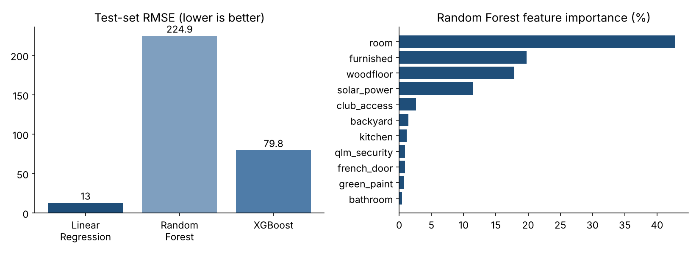

# House Price Prediction

Predicts house prices from 11 property features and compares three regression models: Linear Regression, Random Forest and XGBoost. A course project in machine learning.



## Data
- **3,000 training** and **999 test** records.
- Features: `room`, `bathroom`, `kitchen`, `french_door`, `backyard`, `furnished`, `green_paint`, `solar_power`, `woodfloor`, `qlm_security`, `club_access`.
- Target: `price` (training mean about 8,607, range 2,235 to 15,035).

## Results on the test set
| Model | R-squared | RMSE | MAE | 5-fold CV R-squared |
|---|---|---|---|---|
| Linear Regression | 1.0000 | 13.0 | 13.0 | 1.0000 |
| XGBoost | 0.9987 | 79.8 | 60.1 | 0.9984 |
| Random Forest | not reported on test set | 224.9 | 170.0 | 0.9867 |

## Key findings
- **Linear Regression fits almost perfectly** (R-squared 1.0, average error of 13). This tells us price in this dataset is very close to a straight-line function of the features, which suggests the data is synthetic. On real housing data you would not expect this, so the models here are best read as a comparison exercise.
- **The most valuable features** were room count (42.8% importance in the Random Forest), furnished (19.8%), wood flooring (17.8%) and solar power (11.5%). Bathrooms, green paint and french doors added little.
- All three models agree on the top four features. XGBoost ranks room, wood floor and furnished almost equally.
- Linear Regression was the best model here and also the simplest, so the extra complexity of tree models does not pay off on this data.

## Tools
Python, pandas, NumPy, scikit-learn, XGBoost, PyCaret, matplotlib, seaborn.

## Repository contents
| File | Description |
|---|---|
| `House_Price_Prediction.ipynb` | Notebook with all three models and the comparison |
| `msc_training_dataset.csv` | Training data |
| `msc_testing_dataset.csv` | Test data |

## How to run
```bash
pip install pandas numpy scikit-learn xgboost matplotlib seaborn jupyter
jupyter notebook House_Price_Prediction.ipynb
```
The notebook was written in Google Colab and loads the CSVs from Google Drive. Locally, change the two `read_csv` paths to the CSV files in this folder and remove the Drive mount cell.
